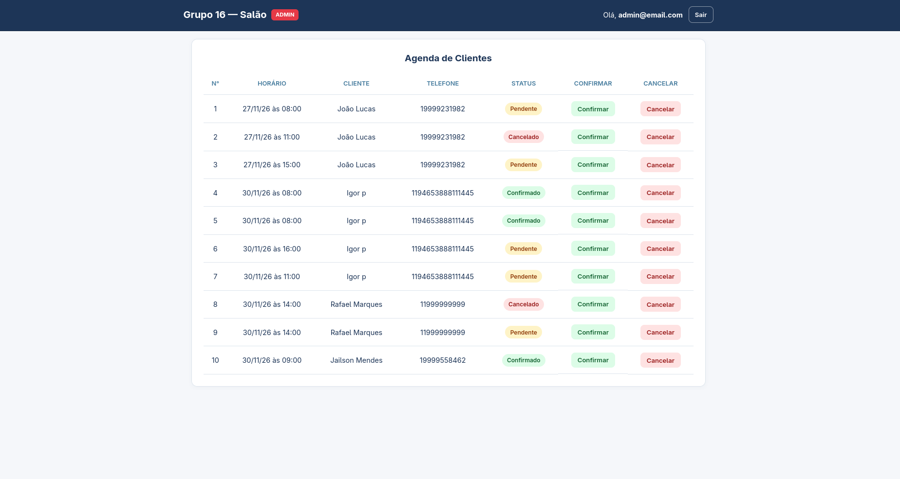

# sistema-agendamento-cabeleireiro
## Projeto integrador do curso de TADS do Senac

Link para projeto hospedado: [https://sistema-agendamento-cabeleireiro.rf.gd/](https://sistema-agendamento-cabeleireiro.rf.gd/)

O sistema consiste em uma api PHP com MariaDB/MySQL que responde à requisições de Javascript via Fetch API, assim atualizando e consultando informações dinamicamente na tela sem recarregamentos para toda requisição.
O cliente cadastrado pode agendar horarios disponíveis e cancelá-los a qualquer momento, mas necessita de aprovação do admin para confirmar o agendamento.
O admin vê todos os agendamentos e pode cancelá-los ou confirmá-los.
Para acessar o painel de usuário é necessário estar logado. E para o painel de admin é necessário estar logado especificamente com o login de admin.

O login de admin (visão do cabeleireiro) pode ser acessado para teste com as credenciais:
- Email: admin@email.com
- Senha: admin

O video de demonstração final pode ser baixado da raiz do projeto: demonstracao_final.mp4

## Screenshot

